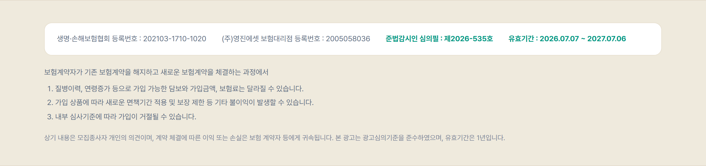
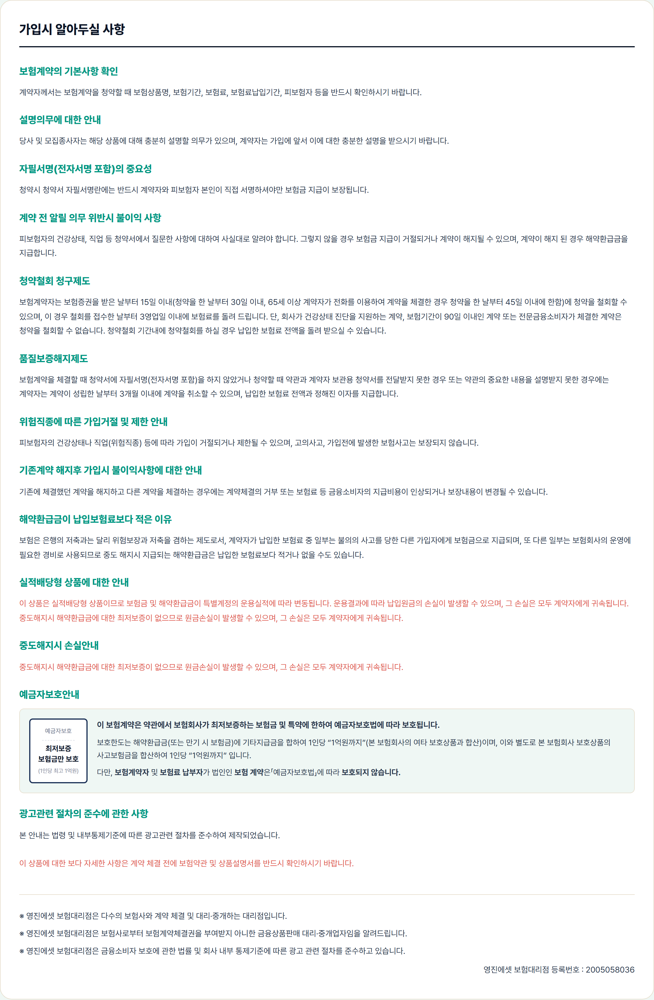
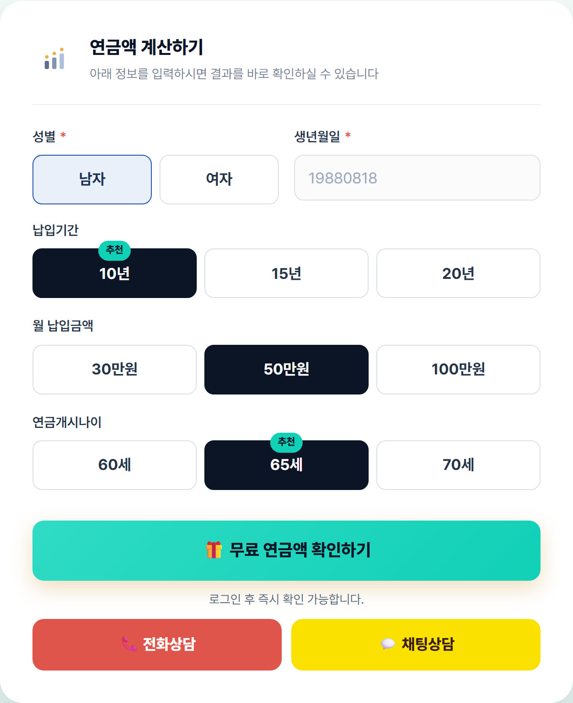
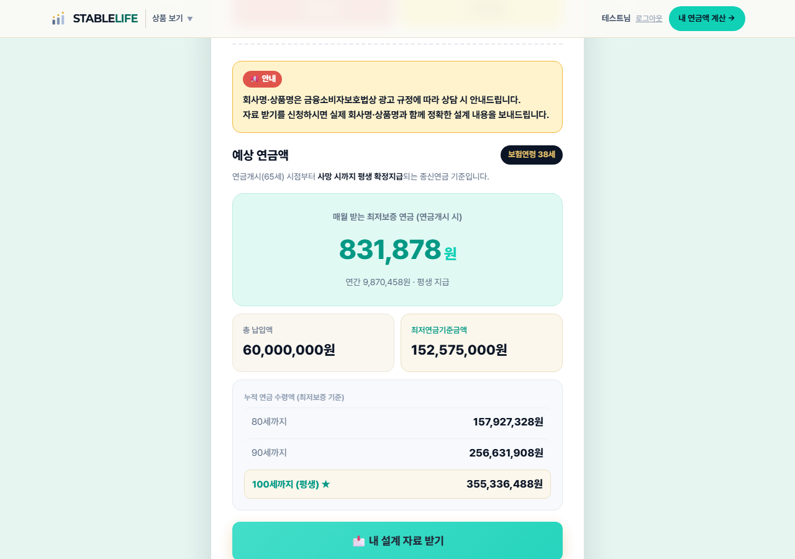
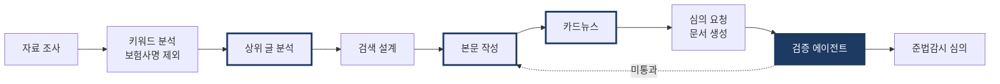
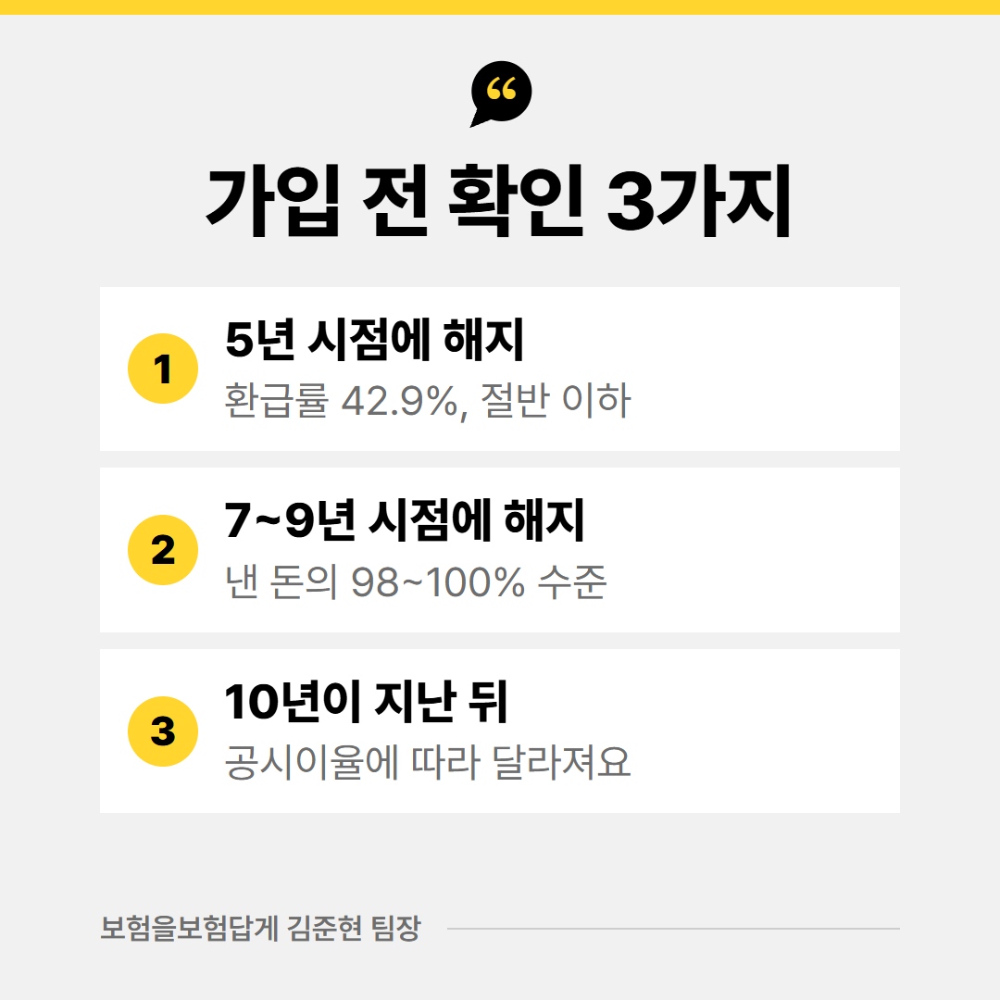
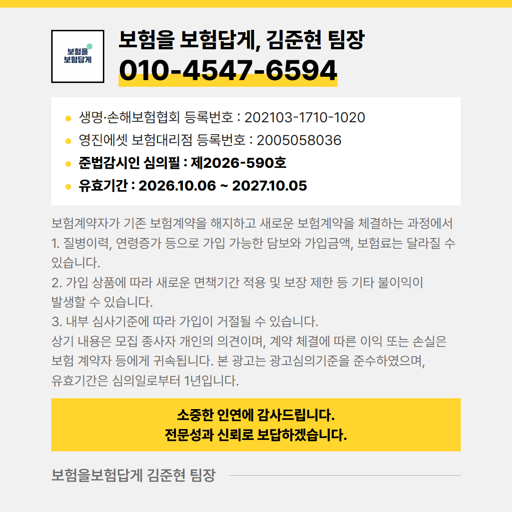

# 금융소비자보호 실무 기록

**김준현** · 법인보험대리점(GA) 보험 컨설턴트 5년 7개월 · shore0903@gmail.com

보험대리점에서 광고 심의를 받는 쪽에 있으면서, 금융소비자보호법 기준을 지키는 절차를 직접 만들고 운영한 기록입니다.
운영 중인 서비스의 코드와 고객 정보는 비공개 저장소에 두고, 이 저장소에는 심의 이력, 점검 기준, 실제 화면만 추려 담았습니다.

| 사례 | 내용 | 자료 |
|---|---|---|
| [1. 광고 사전 심의](#1-광고-사전-심의) | 연금보험 비교 서비스 페이지 10개, 심의필 10건 | [심의 이력](docs/review-log.md) |
| [2. 변경 관리와 재심의](#2-변경-관리와-재심의) | 심의 후 바뀐 문구를 관리하고 재심의 | [재심의 판단 기록](docs/review-log.md#재심의-판단-기록) |
| [3. 판매 절차 개선](#3-판매-절차-개선) | "신청한 적 없다"에서 시작한 동의 절차 변경 | |
| [4. AI 검증 에이전트](#4-ai-검증-에이전트) | 심의 전 금소법 점검 자동화 | [검증 에이전트](docs/review-agent.md) · [제작 단계](docs/pipeline.md) |
| [5. 광고 문구 기준](#5-광고-문구-기준) | 표현별 판단 기준과 그 배경 | [광고 문구 기준](docs/ad-copy-rules.md) |

---

## 1. 광고 사전 심의

**STABLELIFE** 연금보험 비교 서비스 ([stablelife.kr](https://stablelife.kr)) · 2026. 06 ~ 현재 · 기획, 심의 신청, 운영 단독

**배경**
연금보험은 보험사마다 조건과 표기 방식이 달라 고객이 같은 기준으로 비교하기 어렵습니다. 상담에서 반복되던 비교를 웹 서비스로 옮겼고, 계산기와 비교표가 들어간 페이지는 모두 광고라 게시 전에 대리점 준법감시인 심의를 받았습니다.

**한 일**
- 상품 설명과 유의사항은 보험사 상품안내장 원문을 그대로 옮기고, 근거 문서와 쪽수를 페이지별 파일에 기록
- "설계사 참고용, 고객 전달 및 청약 목적 사용 불가"로 표시된 가입제안서는 수치 인용과 심의번호 표기에서 제외
- 회사명, 상품명이 메뉴, 검색 결과, 공유 카드에 노출되지 않도록 표기 위치별 기준 수립
- 계산 결과를 상품안내장 예시 수치와 대조하는 검사를 상품마다 두고 배포 전에 실행 (8개 상품)

```js
// 상품별 기준값은 보험사 상품안내장 예시표의 수치 (검사 코드 발췌, 상품명은 표기 기준에 따라 바꿈)
const CASES = {
  '최저보증 변액연금 40년 7%': {
    source: '상품안내장 p.6 (20세 남자, 10년납, 60세 개시, 월 30만원)',
    insuranceAge: 20, paymentYears: 10, pensionAge: 60, monthlyPremium: 300000, gender: '남자',
    officialBase: 124300000,         // 최저연금기준금액
    officialAnnualPension: 8160000,  // 연 지급액
  },
};
// 안내장 수치가 만원 단위라 허용 오차는 1만원. 넘으면 검사가 실패로 끝난다.
check('최저연금기준금액', minBase, c.officialBase, 10000);
check('연금 연지급액', annualPension, c.officialAnnualPension, 10000);
```

**결과**
2026. 07~10 심의필 10건(제2026-534호 ~ 제2026-591호). 모든 페이지 하단에 심의번호, 유효기간, 승환계약 유의 문구를 표기했습니다. 페이지별 번호는 [심의 이력](docs/review-log.md)에 있습니다.



<details>
<summary>상품 페이지의 "가입시 알아두실 사항" 전체 화면</summary>



</details>

---

## 2. 변경 관리와 재심의

**배경**
서비스를 운영하면 문구와 화면을 계속 고치게 됩니다. 심의 후 내용이 바뀌면 하단의 "본 광고는 광고심의기준을 준수하였으며" 문구가 심의받지 않은 문장까지 보증하는 셈이 됩니다.

**한 일**
- 상품안내장에 없는 문장을 추가한 당일 기존 심의번호를 내리고 재심의 신청
- 재심의 기간에는 심의번호 칸을 비워 두고, 빈 채로 빌드하면 경고가 뜨게 함
- 화면을 바꿀 때마다 재심의 필요 여부를 판단해 변경 기록에 남김

| 날짜 | 변경 내용 | 판단 |
|---|---|---|
| 2026. 08. 02 | 단기납 연금보험 A에 안내장 밖 문장 2개 추가 (환급 조건, 비과세 요건) | **번호 내리고 재심의 신청** |
| 2026. 08. 20 | 같은 페이지의 계산기를 연금액 계산에서 해약환급금 계산으로 변경 | 진행 중인 재심의에 포함 |
| 2026. 08. 20 | 재심의 승인 | **제2026-582호** |
| 2026. 10. 06 | 상품 7개 계산 화면 구성 변경 (로그인 후 결과 공개) | 재심의 필요 여부 확인 대상 |
| 2026. 10. 14 | 결과 화면 안내 문구 교체, 위치 이동 | 재심의 불필요로 판단 |

배포 전 심의번호 확인 (실제 빌드 코드 발췌)

```js
// 심의번호 / 유효기간 placeholder 감지 — 광고 집행 전 실수 방지용 경고
const placeholderChecks = [
  ['reviewNumber', notice.data.reviewNumber],
  ['validFrom', notice.data.validFrom],
  ['validTo', notice.data.validTo],
];
const stillPlaceholder = placeholderChecks.filter(([, v]) => !v || /000|00\.00/.test(v));
if (stillPlaceholder.length) {
  console.warn(`⚠ [${slug}] 아직 확정되지 않은 값이 있습니다:`);
  stillPlaceholder.forEach(([k, v]) => console.warn(`   - ${k}: ${v}`));
}
```

---

## 3. 판매 절차 개선

**배경**
비교 페이지로 상담을 신청한 고객에게 전화하면 "신청한 적 없다"는 답이 여러 번 나왔습니다. 고객이 무엇에 동의했는지 모른 채 정보를 넘겼다는 뜻이어서, 영업 효율이 아니라 동의 절차의 문제로 봤습니다.

**원인**
- 버튼이 '비교하기'로만 되어 있어 상담 신청이라는 고지가 없었음
- 개인정보 동의란이 미리 체크되어 있었음
- 예시 화면과 실제 입력 화면의 모양이 같아 고객이 예시로 오인
- 신청 후 고객이 신청 사실을 다시 확인할 경로가 없었음

**바꾼 것** (2026. 08 ~ 10, 비교 페이지와 상품 페이지 8개에 같은 기준 적용)

| 항목 | 바꾸기 전 | 바꾼 뒤 |
|---|---|---|
| 개인정보 동의 | 미리 체크 | 기본 해제. 체크하지 않으면 제출 불가 (배포 전 자동 검사 항목) |
| 수집 시점 | 계산 전에 이름, 연락처 입력 | 결과는 성별, 생년월일만으로 확인. 이름, 연락처는 상담을 신청할 때만 |
| 연락 고지 | 없음 | 제출 전 "카카오 로그인 후 전화드립니다" 안내 |
| 로그인 안내 | 입력을 마친 뒤 요구 | 입력 전에 로그인이 필요하다는 점을 먼저 안내 |
| 상품명 미표기 | 이유 설명 없음 | 결과 위 공지 상자로 금소법상 광고 규정 때문임을 안내 |
| 처리방침 변경 | | 7일 전 공고 후 시행 (2026. 10. 06 공고, 10. 13 시행) |

<table>
<tr>
<td width="50%"><br><sub>결과 확인 단계. 이름, 연락처를 받지 않음</sub></td>
<td width="50%"><br><sub>금액보다 먼저 보이는 상품명 미표기 안내. 처음엔 버튼 위 회색 글씨라 고객이 보지 못해 옮김</sub></td>
</tr>
</table>

---

## 4. AI 검증 에이전트

보험 정보 블로그 콘텐츠 제작 · 2026. 05 ~ 현재 · Claude Code로 직접 구축

**배경**
글, 카드뉴스, 상품 페이지를 혼자 만들고 심의까지 받다 보니 보험사명 노출, 근거 없는 우위 표현처럼 반려 사유가 되는 실수를 눈으로만 거르기 어려웠습니다. 한 번 잡아낸 문제도 기록하지 않으면 다시 나왔습니다.

**구조**
제작을 8단계로 나누고 단계마다 지킬 기준을 문서로 정해, AI가 그 문서를 읽고 작업하게 했습니다. 마지막 단계의 검증 에이전트가 금소법 항목을 점검하고, 하나라도 걸리면 심의 제출 불가로 판정합니다. 굵은 테두리 3곳은 사람이 승인해야 다음 단계로 넘어갑니다.



**금소법 필수 항목** (전체는 [검증 에이전트](docs/review-agent.md))
- 보험사명 없음
- 상품명 없음 (상품 유형, 특약명으로 우회했는지까지 확인)
- 근거 없는 '최고', '1위' 같은 우위 표현 없음
- "반드시 수익", "무조건 이득" 같은 확정 수익 보장 표현 없음
- 단점과 불리한 경우를 수치로 쓴 주의사항 단락 있음
- 법적 고지 문구가 표준 원문과 글자 단위로 같음

**검토에서 발견한 문제와 추가한 규칙**

| 날짜 | 발견한 문제 | 추가한 규칙 |
|---|---|---|
| 2026. 07. 25 | 보험사 고유 기능명이 상품 분류명과 붙어 메뉴에 노출 | 메뉴, 검색 노출 문구에 고유 명칭 금지 |
| 2026. 08. 02 | 시점 없이 환급률만 강조한 문구 | "확정 환급"은 예시표의 시점과 수치를 함께 |
| 2026. 08. 20 | 고유 기능명을 본문 여러 곳에서 반복 | 같은 문장 안 연속 사용 금지, 패턴 검사 추가 |
| 2026. 10. 01 | 법적 고지 문구가 글 주제에 맞게 바뀌어 나옴 | 표준 원문 고정, 글자 단위 대조 (282자) |

**결과**
본문 작성부터 심의 요청 문서(docx) 생성까지 한 흐름으로 처리합니다. 아래 카드는 이 절차로 만들어 준법감시인 심의필 제2026-590호를 받고 2026. 10. 06 발행한 글에 들어간 것입니다.

<table>
<tr>
<td width="50%"><br><sub>불리한 경우를 수치로 쓴 주의사항 카드. 이 단락이 없으면 검증 미통과</sub></td>
<td width="50%"><br><sub>법적 고지 카드. 표준 원문과 글자 단위로 대조</sub></td>
</tr>
</table>

---

## 5. 광고 문구 기준

심의와 검토를 거치며 정한 표현 기준입니다. 규칙마다 생긴 배경과 적용 방법을 [광고 문구 기준](docs/ad-copy-rules.md)에 적었습니다.

- 회사명, 상품명은 검색 결과와 메뉴에 노출하지 않고 본문의 구조 설명에만 사용
- "확정 환급"은 안내장 예시표로 확인된 시점과 수치에만, 시점을 함께 표기
- 근거 문서는 고객 배포용 상품안내장만. 가입제안서와 원본 문서의 심의번호는 쓰지 않음
- 네이버 검색광고 심사에서 '최저' 같은 최상급 키워드가 막힌 뒤 메인 키워드를 바꾸고 검색량으로 다시 검증
- 지어낸 고객 사례 금지. 실제 상담 사례와 제안서 수치만 사용

그 밖에 보험금 부지급 통보 건을 약관, 분쟁조정 사례, 판례를 근거로 이의 제기해 지급 결정을 받아낸 일, 저축성보험 비과세 요건 안내자료(소득세법 시행령 제25조 기준)를 만든 일이 있습니다.

---

## 이 저장소에 넣지 않은 것

- 고객 정보, 운영 코드, 인증 키
- 보험사 심의가 진행 중인 실명 상품광고 시안 (승인 전 광고라 공개하지 않음)
- 회사명, 상품명 (서비스와 같은 기준으로 표기하지 않음)
